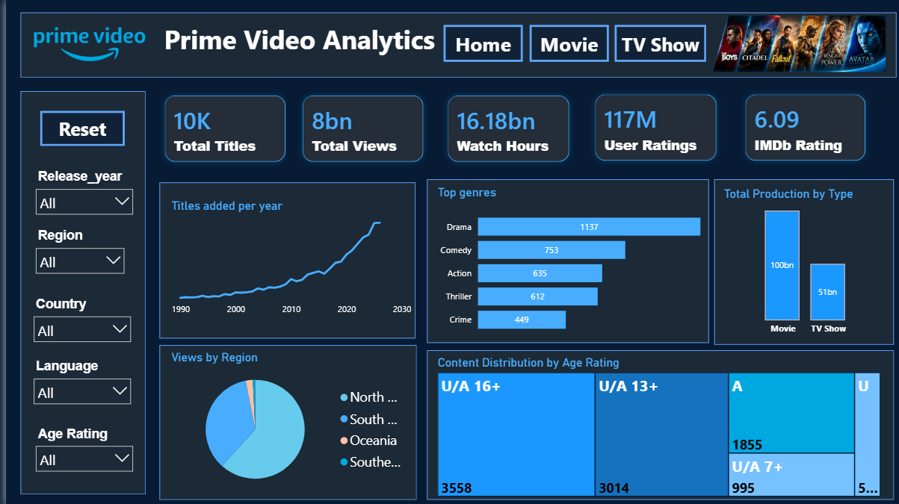
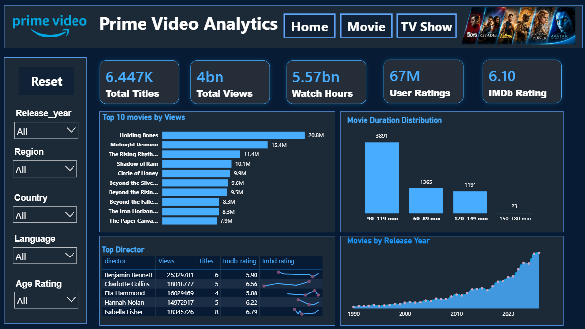
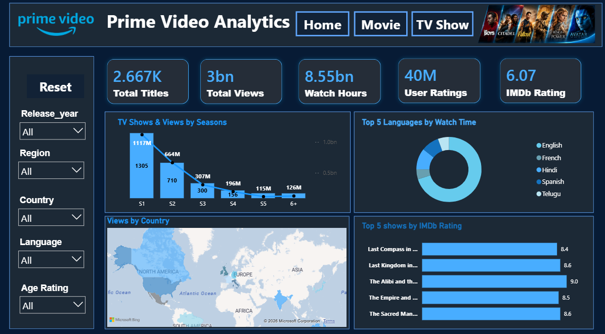

# 🎬 Amazon Prime Video Analytics Dashboard

### Interactive Data Analytics Project | Microsoft Power BI

An interactive Power BI dashboard that explores content distribution, viewership, ratings, and watch-time patterns through Home, Movies, and TV Shows dashboards.

## 🎥 Dashboard Demo

▶️ **[Click here to watch the complete dashboard walkthrough](Dashboard/DASHBOARD%20Demo.mp4)**

---

## 📊 Dashboard Preview

### 🏠 Home Dashboard



**Insights**
- Compared the distribution of Movies and TV Shows.
- Analyzed overall views and watch-time patterns.
- Explored genre-wise performance and regional distribution.

**Business Recommendations**
- Evaluate high-performing genres for future content investment.
- Identify regions with growth potential for targeted promotions.
- Use viewing patterns to support content planning decisions.

---

### 🎬 Movie Dashboard



**Insights**
- Compared movie IMDb ratings and rating counts.
- Explored movie duration distribution.
- Analyzed genre-wise watch time and release-year patterns.
- Identified movies ranking highly by the selected metrics.

**Business Recommendations**
- Consider highly rated movies with sufficient rating counts when evaluating content acquisition.
- Promote relevant movies to improve content discovery.
- Explore genres with strong recorded watch time when planning future investments.

---

### 📺 TV Show Dashboard



**Insights**
- Analyzed TV show distribution across season categories.
- Compared recorded viewership across countries.
- Explored genre and regional viewing patterns.
- Compared TV shows using the available performance metrics.

**Business Recommendations**
- Evaluate high-performing shows when considering future series investments.
- Explore regional marketing opportunities.
- Investigate genres with strong recorded viewership when planning future content.

---

## 📌 Project Overview

This project uses Power BI to transform a synthetic Amazon Prime Video dataset into an interactive analytics dashboard. It explores content performance and presents analytical findings through KPIs, charts, and filters.

## 🎯 Project Objectives

- Analyze Movies and TV Shows distribution.
- Explore viewership and watch-time patterns.
- Examine IMDb ratings and rating counts.
- Compare content performance across genres and regions.
- Analyze movie duration and TV show season distribution.
- Develop business recommendations based on dashboard analysis.

## 🛠️ Tools & Technologies

| Tool | Purpose |
|---|---|
| Microsoft Power BI | Dashboard development and visualization |
| Power Query | Data cleaning and transformation |
| DAX | Measures and analytical calculations |
| Microsoft Excel | Dataset handling |
| GitHub | Project documentation and version control |

## 💡 Business Questions

1. How are Movies and TV Shows distributed?
2. Which genres have the highest recorded total views?
3. Which movies have the highest IMDb ratings?
4. How does watch time vary across release years?
5. Which countries have the highest recorded viewership?
6. How are TV shows distributed across season categories?
7. Which genres contribute more to recorded watch time?
8. How does movie duration vary across the dataset?

## 🧹 Data Preparation & Analysis

1. Imported the dataset into Power BI.
2. Inspected columns and data types.
3. Cleaned and transformed data using Power Query.
4. Prepared fields for visualization.
5. Created DAX measures where required.
6. Developed KPI cards and interactive charts.
7. Configured report filters and visual interactions.
8. Applied consistent formatting across dashboard pages.

## 🎨 Dashboard Design

- Dark navy background with blue accents.
- KPI cards for key metrics.
- Interactive charts and filters.
- Consistent typography and formatting.
- Separate pages for Home, Movies, and TV Shows.

## 📁 Project Structure

```text
amazon-prime-video-analytics/
│
├── Dashboard/
│   ├── Amazon_Prime_Video_Analytics_Dashboard.pbix
│   ├── DASHBOARD Demo.mp4
│   └── Pages/
│       ├── HOMEDASHBOARD.png
│       ├── MOVIEDASHBOARD.png
│       └── TVSHOWDASHBOARD.png
│
├── Dataset/
│   └── prime_video_synthetic_dataset.xlsx
│
└── README.md
```

## 🚀 How to Run the Project

1. Clone or download this repository.
2. Open the `Dashboard` folder.
3. Open the `.pbix` file in Microsoft Power BI Desktop.
4. Explore the dashboard pages and interactive filters.

## 📈 Skills Demonstrated

- Data Cleaning and Transformation
- Power Query
- DAX Measures
- Exploratory Data Analysis
- Data Visualization
- KPI Development
- Interactive Dashboard Design
- Business Insights and Recommendations

## 👩‍💻 Author

**Goli Akshaya**

B.Tech Computer Science and Engineering Student

🔗 **GitHub Repository:** [Amazon Prime Video Analytics](https://github.com/goli-akshaya/amazon-prime-video-analytics)

---

⭐ If you find this project useful, consider starring the repository!
